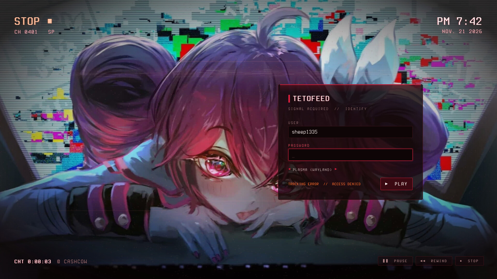

# Tetofeed — SDDM Login

A red twindrilled VHS login for SDDM (Qt6): VCR on-screen display, rolling tracking band, tape grain and tears, crimson-glow glass panel.


Tetofeed is a red twindrilled VHS look for KDE Plasma 6, built around a crimson-lit face on near-black: blood-black surfaces, faint scanlines and tape grain, and a slight crimson glow on whatever has focus.

## Features

- The wallpaper face as a tape on playback: scanlines, flickering grain, a soft tracking band rolling down the screen and a slow drift, like a tape that never quite settles.
- Every 7–16 s a tape tear: a slice of the picture jumps sideways and the frame jitters (set `glitches=false` in `theme.conf` to stop it).
- VCR on-screen display: blinking `PLAY ▶` top left, `AM 11:24` and the date top right, a running tape counter and the host name bottom left.
- Blood-black glass login panel with a crimson glow seam. The password shows as a strip of tape blocks.
- A wrong password flips the OSD to `STOP ■` with a scarlet `TRACKING ERROR // ACCESS DENIED` and a shake. Logging in fast-forwards (`FF ▶▶`) and the screen collapses to a line like a CRT switching off.
- Power controls are transport buttons: `❚❚ PAUSE` (suspend), `◀◀ REWIND` (reboot), `■ STOP` (shut down).
- Pure QtQuick, no shaders: every effect is an image swap or a transform, so it is light on integrated GPUs.



## Requirements

SDDM with the Qt6 greeter (`sddm-greeter-qt6`). The OSD font is bundled.

## Install

```bash
git clone https://github.com/sheepy1335/tetofeed-sddm
cd tetofeed-sddm && sudo ./install.sh
```

<<<<<<< HEAD
Or from the KDE Store: System Settings → Colors & Themes → Login Screen (SDDM) → Get New... → Tetofeed SDDM Login Theme,
- System Settings → Colors & Themes → Login Screen (SDDM) → Install From File...,
- or extract to `/usr/share/sddm/themes/` and pick **Tetofeed** in System Settings → Colors & Themes → Login Screen (SDDM).
=======
Or from the KDE Store: Extract to `/usr/share/sddm/themes/` and pick **Tetofeed** in System Settings → Colors & Themes → Login Screen (SDDM).
>>>>>>> origin/main

## Configuration

`theme.conf`:

| key | default | |
|---|---|---|
| `background` | `assets/background.png` | any image; the face is kept to the left |
| `tagline` | `SIGNAL ACQUIRED // IDENTIFY` | line under the panel title |
<<<<<<< HEAD
| `channel` | `CH 0401` | OSD channel label |
=======
| `channel` | `CH 03` | OSD channel label |
>>>>>>> origin/main
| `glitches` | `true` | `false` stops the tape tears |

## The rest of the suite

| piece | repo |
|---|---|
| Plymouth boot splash | [tetofeed-plymouth](https://github.com/sheepy1335/tetofeed-plymouth) |
| Global theme + splash screen | [tetofeed-global](https://github.com/sheepy1335/tetofeed-global) |
<<<<<<< HEAD
| Plasma splash screen | [tetofeed-splash](https://github.com/sheepy1335/tetofeed-splash) |
=======
>>>>>>> origin/main
| Plasma style (panel, popups) | [tetofeed-plasma](https://github.com/sheepy1335/tetofeed-plasma) |
| Aurorae window decoration | [tetofeed-aurorae](https://github.com/sheepy1335/tetofeed-aurorae) |
| Colour scheme | [tetofeed-colors](https://github.com/sheepy1335/tetofeed-colors) |
| Kvantum widget style | [tetofeed-kvantum](https://github.com/sheepy1335/tetofeed-kvantum) |
| Icon theme | [tetofeed-icons](https://github.com/sheepy1335/tetofeed-icons) |
| Konsole + kitty colours | [tetofeed-konsole](https://github.com/sheepy1335/tetofeed-konsole) |

Everything at once, with the generators: [tetofeed](https://github.com/sheepy1335/tetofeed).

## Tags

`tetofeed` `kde` `plasma6` `dark` `vhs` `scanlines` `crimson` `red` `blood` `horror` `retro` `analog-horror` `glow` `sddm` `sddm-theme` `login-screen` `qt6` `qml` `vcr` `osd`

## Credits and licence

<<<<<<< HEAD
- By sheepy1335, customised from [Bloodfeed SDDM](https://github.com/numbpill3d/bloodfeed-sddm) by numbpill3d. GPL-3.0-or-later.
- Wallpaper is from [wallpapers.com](https://wallpapers.com/wallpapers/kasane-teto-digital-art-qtho2b0qil6f2n3q.html)
- OSD font: Terminess Nerd Font (Terminus, SIL OFL 1.1), bundled with its licence.
=======
By sheepy1335. GPL-3.0-or-later.
OSD font: Terminess Nerd Font (Terminus, SIL OFL 1.1), bundled with its licence.
>>>>>>> origin/main
